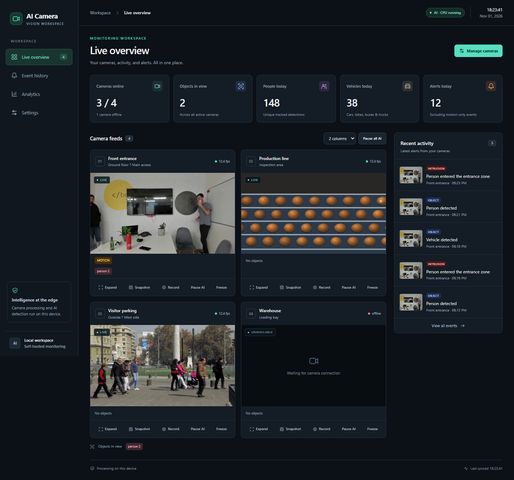
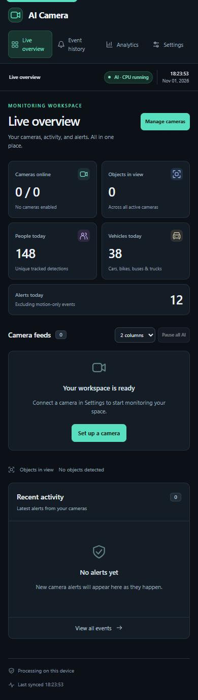
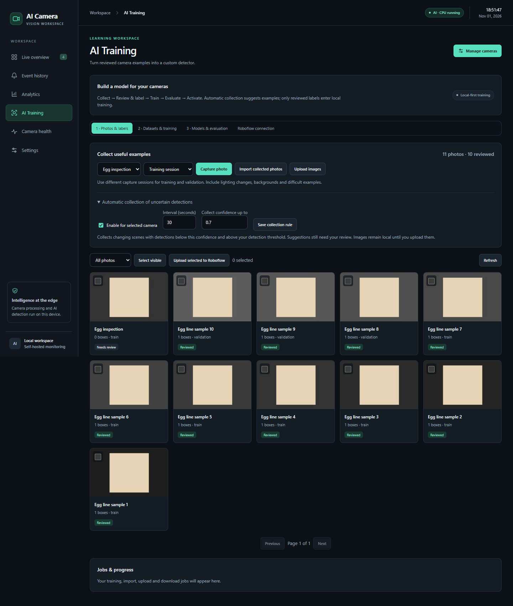
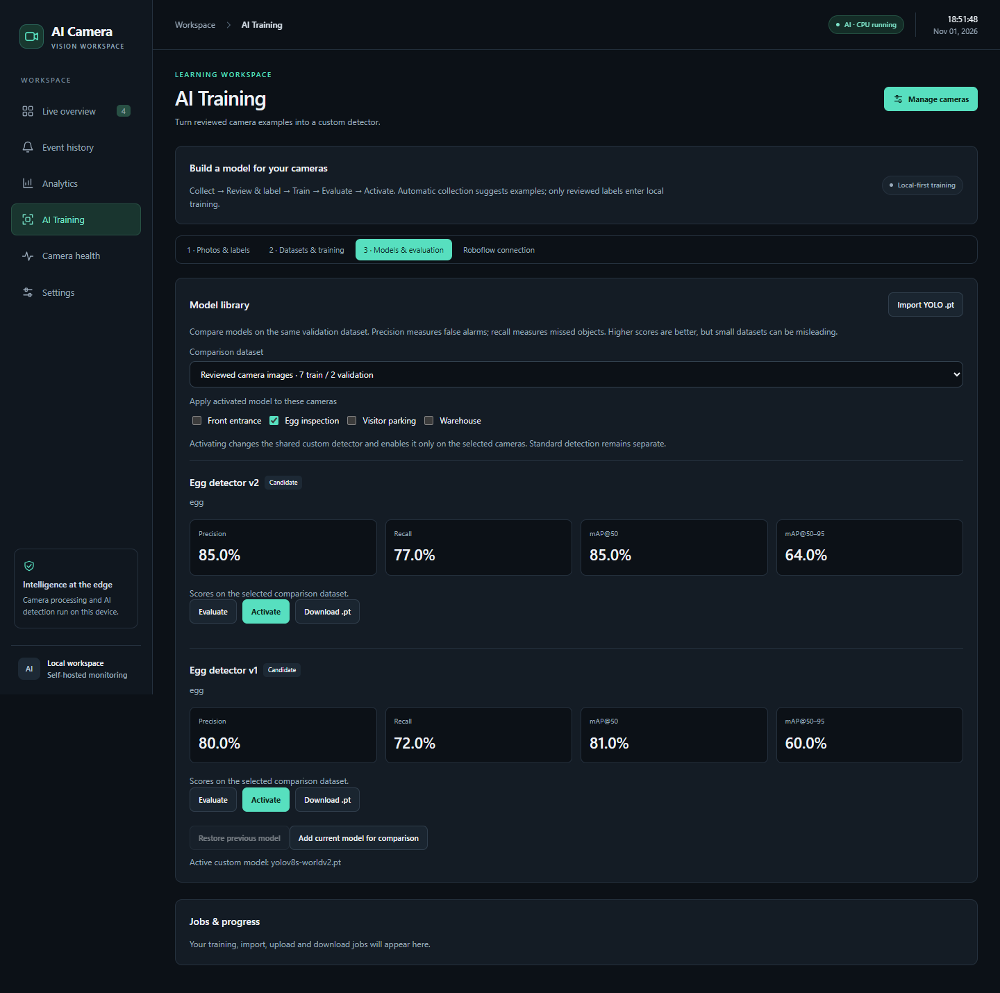
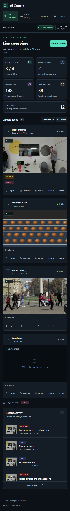

# AI Camera

Self-hosted AI CCTV dashboard: live cameras, object detection and tracking, zones, line counting,
pose and fall detection, face blur, heatmap, motion, alerts with photos and clips, Telegram, analytics,
and quality inspection (anomaly detection, e.g. egg lines). Monitoring and local training run on your device.
Roboflow upload/download and cloud training are optional, explicit actions.

- **Hailo-8 / 8L** (Raspberry Pi 5, CM5) runs detection, pose and faces on the AI chip.
- **Any PC without Hailo** falls back to CPU (Ultralytics YOLO), slower.



## Screenshot guide

**Live overview** — all cameras, KPI tiles (cameras online, objects in view, people/vehicles today, alerts),
the camera-feed grid with per-feed Expand / Snapshot / Record / Pause / Freeze, and a Recent activity feed.


**First run** — before any camera is added you get an empty state. Click **Set up a camera** (or **Manage cameras**)
to open Settings → Cameras.



**AI Training → Photos & labels** — capture or upload frames, split them into training/validation sessions,
draw boxes, and mark each photo reviewed. Only reviewed labels enter local training.



**AI Training → Models & evaluation** — compare candidate detectors on the same validation set
(precision, recall, mAP@50, mAP@50–95), then activate one on the cameras you choose.



**On a phone** — the whole dashboard is responsive and works in a mobile browser.



## Run on a PC (Windows / Linux)

```
python -m venv .venv
.venv/Scripts/pip install -r requirements.txt   # Linux: .venv/bin/pip
.venv/Scripts/python app.py
```

Open http://127.0.0.1:8080 and log in with `admin` / `admin` (change it in Settings → Login).
Add cameras in Settings → Cameras (RTSP brands, USB webcam, HTTP stream, video file; **Find cameras** scans the network).

## Install on a Raspberry Pi with Hailo

```
bash install.sh
```

Installs dependencies, registers the `ai-camera` service (starts on boot) and runs the self-check.
Quality inspection additionally needs PyTorch (`pip install torch torchvision`).

## Demo videos

`python make_demo_eggs.py` creates synthetic egg-line videos in `demo-videos/` for trying inspection without a real line.

## Custom objects (e.g. egg)

Settings → Detection → Custom objects. `yolov8s-worldv2.pt` finds objects by name with no training.
Use **AI Training** to collect, label, train, evaluate and activate a compatible Ultralytics object detector.
Custom detectors currently run on CPU. Downloading a `.pt` model does not compile it for Hailo; Hailo's
standard detection/pose/face models still use their configured `.hef` files.

## Monitoring workspace

- Set a **camera group** in Settings → Cameras. Search cameras by name, location or group on Live overview.
- **Focus** enlarges a feed while keeping the remaining feeds alongside it. Exit focus restores the grid.
- **Camera health** shows frame timestamps, connection times, AI FPS and reconnection attempts since startup.
- Filter **Event history** by dates (browser-local time), severity and review status. Open an event to mark
  it confirmed, a false alarm or unreviewed, with a note. These reviews do not automatically label training images.
- Settings are organized into Cameras, Detection, Recording, Notifications and Login tabs.

## Reviewed training workflow

Install training dependencies into the same virtual environment:

```
.venv/Scripts/python -m pip install -r requirements-training.txt
```

1. In **AI Training → Photos & labels**, capture frames, upload JPEG/PNG images, or import the latest 500
   photos from the existing per-camera collection tool. Optional uncertain-detection collection is off by default,
   samples changing scenes at a bounded interval, and never marks its own guesses as reviewed.
2. Open each photo, draw or enter object boxes, assign classes, and check the review checkbox. An image with
   no target objects can be reviewed with zero boxes. Corrections replace suggested boxes.
3. Choose training, validation or test **capture sessions**. Use independently captured scenes to avoid near-duplicate
   frames leaking across splits. At least two training and two validation images are required; this is only a functional
   minimum, not enough for a production-quality model. Exact cross-split duplicates are rejected.
4. Build a dataset snapshot, or import a YOLO detection ZIP containing `data.yaml`, image folders and labels.
   Imports support `train/images`, `valid/images` (or `val/images`), optional `test/images`, and `images/train` layouts.
   Classification, segmentation and pose datasets are not accepted. ZIP import is capped at 1 GB compressed / 4 GB unpacked.
5. Start local training from the installed `yolov8n.pt` or a model in the library. CPU is the default; GPU 0 requires
   a working CUDA PyTorch installation. Training runs in a separate cancellable process; monitoring may run slower.
6. Use **Add current model for comparison** to copy the existing custom detector into the model library.
   Compare candidates on **the same dataset** using precision, recall, mAP@50 and mAP@50–95. Imported models must
   be evaluated before activation. The dataset class names and order must match the candidate model.
7. Select cameras and activate the candidate. Activation updates the shared custom detector and enables it on those
   cameras only. The previous model, class names and per-camera custom-detection selection are retained for rollback.

Dataset snapshots are immutable; editing/deleting source photos does not change an existing snapshot. Both datasets
and model weights can be downloaded from their library. Jobs interrupted by a server restart are marked interrupted;
they do not silently restart or activate models. Only import model weights from sources you trust.

## Roboflow

Enter a private API key, workspace slug and project slug under **AI Training → Roboflow connection**.
The key stays in ignored server-side `ai-workspace/connection.json`; API responses never include it.
No account access is needed for the local workflow. There is no automatic cloud synchronization.

- Select photos and choose **Upload selected to Roboflow**. Reviewed boxes upload as annotations; unreviewed
  suggestions do not. Successful uploads are tracked per destination and annotation revision, so retrying skips
  unchanged photos already uploaded. Use the project link to finish labeling and generate a version on Roboflow.
- **Download YOLO dataset** imports the selected dataset version for local training.
- **Download model weights** accepts a model slug or version number and checks compatibility. A `.pt` extension
  alone does not imply compatibility: this application supports Ultralytics object detection, not RF-DETR or other runtimes.
- **Submit cloud training** explicitly starts a job using the model type identifier supported by your Roboflow project
  (leave it blank to use Roboflow's default).
  This can consume account credits. Cloud jobs are monitored using **Refresh cloud status**; manage cloud cancellation
  from Roboflow. If submission times out, check Roboflow before submitting again to avoid duplicate paid jobs.

Supported exports and model identifiers depend on Roboflow and the project's architecture. Integration endpoints follow
the [official Roboflow API adapter](https://github.com/roboflow/roboflow-python/blob/main/roboflow/adapters/rfapi.py).

## Self-check

```
python test_app.py
python -m unittest test_workspace -v
```

Optional real training smoke check (one epoch on synthetic fixture images, never deployed):

```
# PowerShell
$env:RUN_TRAINING_SMOKE='1'
.venv/Scripts/python -m unittest test_workspace.WorkspaceTests.test_real_one_epoch_training_and_validation -v
```

`settings.json` (passwords), events, learned models, training photos, and `ai-workspace/` (datasets, labels,
credentials, job logs, registry and model versions) are ignored by Git. Back up these folders to retain learning history.
